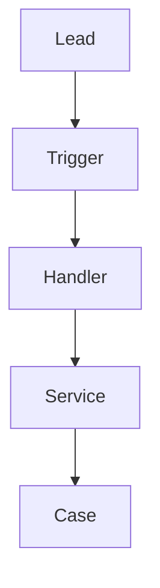
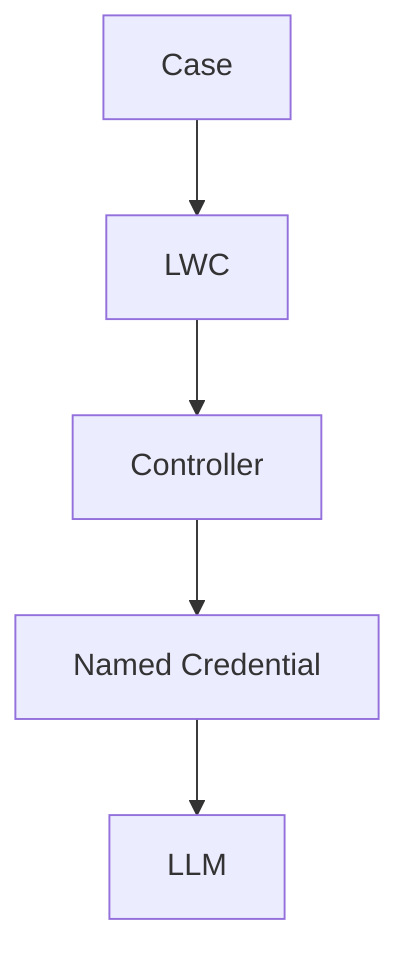

# Architecture

ServiceGenie splits work into two paths. The first path is Sales Cloud and Service Cloud record handling inside the org. The second path is a callout from a Case to a language model. The callout returns a draft that a person approves or rejects.

This project targets Salesforce Developer Edition only. It does not use Enterprise Edition, a sandbox, a production org, real customer data, or Agentforce.

## Repository Layout

| Path | Role |
| --- | --- |
| `force-app/main/default/` | Default Salesforce DX package directory. Lead automation, the case assistant, and `AI_Draft__c`. |
| `servicegenie/` | Reserved for later synthetic fixtures so sample payloads are not stored as metadata. Marker only. |
| `manifest/package.xml` | Lead-to-case metadata, the case assistant, and `AI_Draft__c`. API 68.0. No credential metadata. |
| `config/project-scratch-def.json` | Scratch org shape. Creating a scratch org needs a Dev Hub, which this project does not assume. |
| `docs/` | Architecture, object model, standards, governance, credentials, drafts, and test strategy. |
| `scripts/` | Local runners for the repository tests. |
| `tests/` | Python tests that check the repository. They are not Apex tests. |
| `.github/workflows/` | Runs the repository tests and the Jest suite. |

No namespace is registered. `sfdx-project.json` leaves `namespace` empty. Login uses `https://login.salesforce.com`, which is the Developer Edition login host. That host is not a claim of production access. Setup steps are in `docs/org_setup.md`.

## Lead to Case Path

A support lead becomes one Case. Business rules live in a service class. The trigger only hands the batch to the handler.

```
Lead
↓
Trigger
↓
Handler
↓
Service
↓
Case
```



| Step | Responsibility | State |
| --- | --- | --- |
| Lead | Stores the inbound request and `Request_Type__c`. | `Request_Type__c` is in source. Support inserts are set to `Routed to Support`. |
| Trigger | One trigger on Lead. It calls the handler. It contains no SOQL, no DML, and no branching. | `LeadTrigger` delegates to `LeadTriggerHandler.run()`. |
| Handler | Switches on `Trigger.operationType` and calls the service once per operation. | `LeadTriggerHandler` handles before insert, after insert, and after update. |
| Service | Support leads only. One intake Case on insert. One onboarding Case when a support lead is converted. Bulk query, bulk insert. | `LeadToCaseService`. |
| Case | The service record. `Source_Lead__c` points back at the lead. | Lookup is in source. Delete constraint is Restrict. |

Sales leads stop in the service. They do not continue to Case creation. Details of arrival, qualification, routing, case creation, and converted-lead handling are in `docs/design.md`.

## Case to LLM Path

A person working a Case can request a draft. The Lightning Web Component talks to Apex. Apex calls out through a Named Credential. The model returns text. Apex inserts an `AI_Draft__c` record. The component shows that record and waits for a person.

```
Case
↓
LWC
↓
Controller
↓
Named Credential
↓
LLM
```



| Step | Responsibility | State |
| --- | --- | --- |
| Case | The record the agent is viewing in the Service Console. | `caseAssistant` reads it from the Case record page. |
| LWC | Shows case context, history, and the draft card. Generate, approve, and reject call Apex. Next actions stay disabled. The component does not hold a secret and does not call the model. | `caseAssistant` is in source. |
| Controller | Reads the case with sharing and user mode. Generate, approve, and reject delegate to `DraftService`. | `CaseAssistController`. It does not set an HTTP header or send email. |
| Named Credential | Org configuration that names the callout endpoint and points at an External Credential for authentication. Apex uses `callout:LLM_API`. The credential stores the secret in the org. | Designed in M5 as `LLM_API`. Not deployed. No credential metadata is in `force-app`. |
| LLM | The external model. It returns draft text. It does not update Salesforce and it does not send mail. | `LlmClient` calls `callout:LLM_API`. Tests use `HttpCalloutMock`. |

The diagram order is Case, then LWC, then Controller, then Named Credential, then LLM. The LWC never calls the Named Credential on its own. That keeps the secret and the HTTP call on the server.

### Named Credential and External Credential

These were not configured until M5. M5 names the credential `LLM_API` and the external credential `LLM_External`. No credential metadata is deployed, because no Developer Edition org is authorized from this workspace. The secret is not in source. The full design is in `docs/credential_architecture.md`.

- The External Credential uses custom authentication and a named principal. The secret is entered in the org setup UI. It is not a custom metadata record, a custom setting, or a source file.
- The Named Credential selects the endpoint URL and the External Credential. The placeholder URL is `https://llm.example.com`. It has no user name, password, or key.
- Apex callouts use `callout:LLM_API`. Tests use `HttpCalloutMock`. Tests do not reach the network.
- Remote Site Settings are not a substitute. They do not store credentials in a managed way, and this project does not use them for the model.
- Credential metadata stays out of `namedCredentials/` and `externalCredentials/` until an org is available to configure it.

## Runtime Boundaries

- Salesforce remains the system of record. The model is not a second database.
- Draft text is written only to `AI_Draft__c` after a person requests it. Nothing is sent automatically.
- Platform events, flows, and agents that would call the model without a person are out of the architecture.
- Agentforce is not a component in either path.

## Source Shape

Metadata, when later milestones add it, uses Salesforce DX source format under `force-app/main/default/`. API version is 68.0 (Winter '27) in both `sfdx-project.json` and `manifest/package.xml`.

| Folder | Contents |
| --- | --- |
| `classes/` | Lead-to-case classes, `CaseAssistController`, `DraftService`, and `LlmClient`, with tests. |
| `triggers/` | `LeadTrigger` only. |
| `lwc/` | `caseAssistant`. |
| `objects/` | `Lead.Request_Type__c`, `Case.Source_Lead__c`, and `AI_Draft__c`. |
| `permissionsets/` | `ServiceGenie_Lead_To_Case` and `ServiceGenie_AI_Draft`. |
| `namedCredentials/` | Empty. `LLM_API` is documented, not deployed. |
| `externalCredentials/` | Empty. `LLM_External` is documented, not deployed. |

`servicegenie/` is outside the package directory on purpose. Synthetic JSON fixtures used by tests or scripts in a later milestone stay there, not inside `force-app`.
