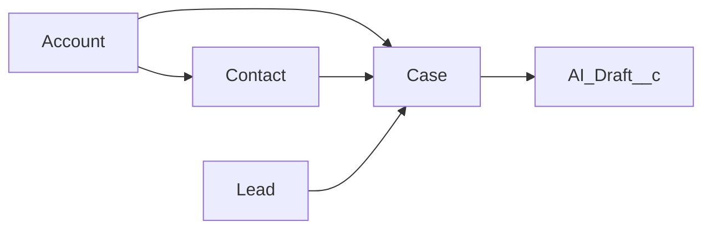

# Object Model

Five objects form the demo. Lead, Account, Contact, and Case are standard. `AI_Draft__c` is a custom object specified here and not deployed. Custom fields in this document are the M1 contract. They are not in `force-app` yet.

All records are synthetic. Use reserved example names and `@example.com` addresses. Do not import a customer extract.

This project targets Salesforce Developer Edition only. It does not use Enterprise Edition, a sandbox, a production org, real customer data, or Agentforce.

Org-wide defaults, queues, and role hierarchy are unchanged in M1. Do not assume a private sharing model is already in place. A later milestone sets sharing and tests it.

The Lead-to-Case arrow is the custom lookup `Case.Source_Lead__c`. It is not lead conversion. Conversion links a Lead to an Account, Contact, and Opportunity only after a Sales conversion, through `ConvertedAccountId`, `ConvertedContactId`, and `ConvertedOpportunityId`.

## Lead

### Purpose

Lead is the intake record for a person or company that has asked for something and has not yet been placed on a sales path or a support path. It exists so Sales Cloud can qualify the request before Service Cloud opens a Case.

### Relationships

- `Request_Type__c` (specified, not deployed): restricted picklist, values `Sales` and `Support`.
- Standard conversion lookups, populated only after a real conversion: `ConvertedAccountId`, `ConvertedContactId`, `ConvertedOpportunityId`.
- Cases that came from this lead: child Case records where `Source_Lead__c` equals this lead. The relationship name on the lookup will be `Cases`.
- No direct relationship to `AI_Draft__c`. Drafts hang off the Case.

### Ownership

`OwnerId` is a user. M1 does not create a Lead queue. The creating user owns arrivals. A later milestone may add a support intake queue; that queue is not part of the M1 org setup.

Sharing is whatever the Developer Edition org already uses. This repository does not deploy an org-wide default.

### Lifecycle

1. Lead Arrival. The lead is created with `Request_Type__c` blank and an open status. No Case exists.
2. Lead Qualification. A person sets `Request_Type__c` to `Sales` or `Support`.
3. Support Routing. A Support lead moves to Lead Status `Routed to Support`. That status is not a converted status. `IsConverted` stays false. A Sales lead never uses this status.
4. Case Creation. `LeadToCaseService` inserts one intake Case and sets `Source_Lead__c`. The lead itself stays unconverted.
5. Converted Lead Handling. A Sales lead may go through standard conversion, which locks it and does not create a Case. Routing does not convert a Support lead. If a person later converts a Support lead, the intake Case remains, `Source_Lead__c` still points at the locked lead, and M2 adds one onboarding Case for the converted contact. The service does not update a lead that is already converted.

Full routing rules are in `docs/design.md`.

## Account

### Purpose

Account is the organization or household a Contact and a Case belong to. In this demo it represents a synthetic company, not a customer of record from a real business.

Sales conversion may create an Account from a Sales lead. Support routing does not create an Account.

### Relationships

- Parent of Contact through `Contact.AccountId`.
- Parent of Case through `Case.AccountId`.
- Related to Lead only after conversion, through `Lead.ConvertedAccountId`.
- No direct child relationship to `AI_Draft__c`.

### Ownership

`OwnerId` is a user. M1 does not assign an account owner from the lead-to-case path, because that path does not create accounts.

### Lifecycle

- A synthetic Account may be created by hand for console demos, or by standard lead conversion on the Sales path.
- The Account stays active for the demo. There is no custom status field in M1.
- Closing a Case does not change the Account.
- Accounts are not deleted as part of the support flow. Storage in a Developer Edition org is small, so demo data stays to a handful of accounts. Limits are listed in the README.

## Contact

### Purpose

Contact is the person on an Account. A Case can name the Contact as the requester. Support routing does not require a Contact and does not convert a Lead to create one.

### Relationships

- `AccountId` looks up to Account. A Contact in this demo should have an Account before it is placed on a Case.
- Cases reference the Contact through `Case.ContactId`.
- A converted Sales lead points at the Contact through `Lead.ConvertedContactId`.
- `AI_Draft__c` does not look up to Contact. The draft reads context through the parent Case.

### Ownership

`OwnerId` is a user. M1 does not reassign contacts.

### Lifecycle

- Created by hand as synthetic data, or by standard Sales lead conversion.
- Linked to a Case only when a person sets `ContactId`, or when a later milestone has a real converted contact to use.
- The support path must keep working when `ContactId` is null.
- Contacts are not merged, deleted, or emailed by this design.

## Case

### Purpose

Case is the Service Cloud work item. It is the record an agent opens to read the request and, in a later milestone, to review an AI draft. A Case created by the support path is the service record for one support lead.

### Relationships

- `Source_Lead__c` (specified, not deployed): lookup to Lead, delete constraint Restrict, relationship name `Cases`. Populated only when the Case was created from a lead.
- `AccountId` and `ContactId`: standard lookups. Both may be null for a case that came from an unconverted support lead.
- `OwnerId`: the agent or, later, a case queue. No queue is created in M1.
- Child `AI_Draft__c` records through a master-detail `Case__c` once that object exists.
- No lookup to Opportunity. Support cases are not sales pipeline items.

### Ownership

The Case owner is the user who is responsible for the work. M1 does not deploy assignment rules, escalation rules, or queues. Those would send or reshuffle work, and this milestone does not automate Case handling.

Access for child drafts will follow the Case once `AI_Draft__c` is a master-detail child.

### Lifecycle

The status model is the standard Case status set. M1 does not deploy a support process.

| Status | Meaning |
| --- | --- |
| New | Created from a support lead, or entered by hand. No draft has been requested. |
| Working | An agent owns the investigation. |
| Escalated | A person escalated the case. This design does not auto-escalate. |
| Closed | A person closed the case. Closing does not send email and does not delete drafts. |

A Waiting status may be used if the org already has one. Automation must not depend on a status this project has not added.

Case creation rules:

- The intake Case comes from a lead whose `Request_Type__c` is `Support`. Before insert, that lead's status is `Routed to Support`. A person can still create a Case directly.
- One intake Case per source lead. Converting that support lead adds one onboarding Case linked to the converted contact. It does not add a second intake Case and it does not clear `Source_Lead__c`.
- Origin uses the existing standard value `Web`.
- The Case is closed by a person. It is not deleted. Deleting a Case would delete child drafts once the master-detail exists, so the demo closes cases instead.

Converted Lead Handling for the Case: the intake Case stays, and a converted support lead gains one onboarding Case for `ConvertedContactId`. A converted sales lead gains no Case.

## AI_Draft__c

### Purpose

`AI_Draft__c` stores one proposed reply for a Case. The record is the only place model output is saved. It exists so a person can read, approve, or reject the text, and so the decision is auditable.

The object is in source. `DraftService` fills Original Draft from `LlmClient`. Named Credential `LLM_API` is documented and not deployed, because no org is authorized. The record is a draft. It is not an outbound email.

### Relationships

Specified fields, deployed with the object:

| API name | Type | Role |
| --- | --- | --- |
| `Case__c` | Master-Detail to Case | Parent. Required. Sharing follows the Case. A draft cannot exist without a Case. |
| `Original_Draft__c` | Long Text Area | The model reply. Later edits do not replace it. |
| `Edited_Draft__c` | Long Text Area | Starts as a copy of the original. Approve can store the person's edit here. |
| `Status__c` | Restricted picklist | `Draft`, `Approved`, `Rejected`. |
| `Model_Name__c` | Text | Provider model label returned with the draft. Not a secret. |
| `Prompt_Version__c` | Text | Version label of the prompt template. The template itself is not stored with customer data. |
| `Approved_By__c` | Lookup to User | The person who approved or rejected. Blank until a decision. |
| `Approved_At__c` | Date/Time | When the person decided. Blank until a decision. |

`Status__c` moves to `Approved` or `Rejected` only when `Approved_By__c` and `Approved_At__c` are set together. `DraftService` enforces that, and the validation rule `Decision_Requires_Approver` blocks a decision row that is missing either value. The running user must be a standard user.

There is no lookup to Lead, Account, or Contact. Follow the Case for that context.

Deleting a Case deletes its drafts because of the master-detail. The operating rule is to close cases, not delete them, so the audit rows stay.

### Ownership

Master-detail ownership is controlled by the parent Case. There is no separate draft queue. `Approved_By__c` records the decision maker and is not the record owner.

A guest, site, or automated user is not a valid approver.

### Lifecycle

| Status | Who sets it | What it means |
| --- | --- | --- |
| `Draft` | `DraftService.generateDraft`, after a person requests a draft and the callout returns 200 | Text is stored. Nothing is sent. |
| `Approved` | `DraftService.approveDraft` | The person accepts the wording. The record remains a draft. No `EmailMessage` is created. Only this status may continue to a later send. |
| `Rejected` | `DraftService.rejectDraft` | The wording is declined. The Case stays open. A later request inserts a new draft rather than overwrite the rejected body. |

Rejected and approved rows are kept. The controller must not delete them to "clean up" a case.

Field history on `Status__c` is part of the later object setup so status changes are visible even if a value is overwritten. Standard `CreatedById`, `CreatedDate`, `LastModifiedById`, and `LastModifiedDate` apply as soon as the object exists.

## Lead to Case Field Contract

These names are stable for later milestones:

- `Lead.Request_Type__c` with values `Sales` and `Support`
- Lead Status `Routed to Support`, Converted unchecked
- `Case.Source_Lead__c` lookup to Lead

The sequence those fields support is Lead Arrival, Lead Qualification, Support Routing, Case Creation, and Converted Lead Handling. Behavior for each step is defined in `docs/design.md`.
