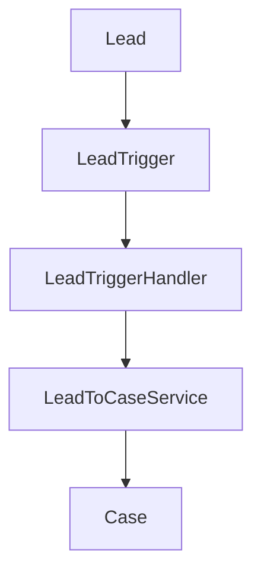

# Trigger Architecture

Lead automation has one trigger, one handler, and one service. The trigger does not decide which leads become cases. The service does.

```
Lead
↓
LeadTrigger
↓
LeadTriggerHandler
↓
LeadToCaseService
↓
Case
```



## Trigger

`LeadTrigger` is the only trigger on Lead. It listens to before insert, after insert, and after update. The body is one call:

```apex
LeadTriggerHandler.run();
```

There is no SOQL, no DML, and no request-type branch in the trigger. A second Lead trigger is a defect.

## Handler

`LeadTriggerHandler.run` switches on `Trigger.operationType`.

| Operation | Service method | Work |
| --- | --- | --- |
| `BEFORE_INSERT` | `routeNewSupportLeads` | Support leads move to `Routed to Support` in memory. |
| `AFTER_INSERT` | `createSupportCases` | One intake case per support lead. |
| `AFTER_UPDATE` | `createOnboardingCases` | One onboarding case when a support lead becomes converted. |

Other operations are not registered on the trigger, so the handler does not run for them. The handler does not query and does not insert. It passes `Trigger.new` and, on update, `Trigger.oldMap`.

## Service

`LeadToCaseService` is `with sharing`. Public methods take lists. They return immediately when automation is disabled or the list is empty.

The three methods share private helpers that:

- collect lead Ids and emails into sets
- query cases once and contacts once
- store rows in maps
- build one list of cases and insert that list once

Field rules, contact matching, and the onboarding case are specified in `docs/apex_design.md`. Query and DML totals are specified in `docs/bulk_processing.md`.

## Trigger Control

Administrators need a way to pause this path without commenting out the trigger. The planned control is a custom metadata flag named Automation Enabled.

| Item | Value |
| --- | --- |
| Type | `Trigger_Control__mdt` |
| Field | `Automation_Enabled__c` |
| Future record | `Lead_To_Case` |

Purpose: when the flag is false, the handler can still run and the service returns before it changes a lead or inserts a case. Tests and a fresh org keep working when the record is absent, because a missing flag is treated as enabled.

Future implementation reads it with `Trigger_Control__mdt.getInstance('Lead_To_Case')` so the read does not add a counted SOQL query. No custom metadata record is deployed in M2, and the metadata type is not in the project yet. `isAutomationEnabled` returns true.

## Sharing and Access

The service runs `with sharing`, so a user who cannot create a case cannot complete a support-lead insert. Field access for the two custom fields is granted by the permission set `ServiceGenie_Lead_To_Case`. Standard profiles are not edited.

The service does not send email, does not call out, and does not write `AI_Draft__c`.
